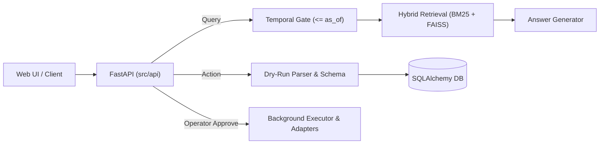

# Chronexa

Point-in-time workplace memory search and approval-gated action assistant for engineering and operations teams.

[](https://github.com/Spidey173/Chronexa/actions/workflows/ci.yml)
[](https://python.org)
[](LICENSE)

**Live Demo:** [chronexa17.vercel.app](https://chronexa17.vercel.app/) | **API Health:** [chronexa-api.vercel.app/health](https://chronexa-api.vercel.app/health)

## Key Features

- **Answer questions as of any past timestamp:** Filters out messages, edits, and deletions created after your chosen `as_of` time so future updates never leak into historical answers.
- **Refuse to guess when evidence is missing:** Returns a clear abstention instead of fabricating facts when nothing in the indexed workspace covers the question.
- **Preview and approve actions before anything runs:** Turns natural-language requests into validated dry-run proposals that require an operator's approval before background execution.
- **Trace every decision:** Records who proposed, approved, or rejected each action in a persistent audit log.

## Tech Stack

Python 3.11/3.12, FastAPI, SQLAlchemy, Alembic, SQLite/PostgreSQL, FastEmbed (ONNX), FAISS, BM25, Vanilla JS.

## Quick Start

```bash
git clone https://github.com/Spidey173/Chronexa.git
cd Chronexa
python3 -m venv .venv && source .venv/bin/activate
pip install -r requirements.txt
cp .env.example .env
python src/server.py
```

Open `http://127.0.0.1:8000` for the web UI or `http://127.0.0.1:8000/docs` for interactive Swagger API docs. Run tests with `pytest` (after `pip install -r requirements-dev.txt`).

| Variable | Default | Purpose |
| :--- | :--- | :--- |
| `DATABASE_URL` | `sqlite:///./chronexa.db` | Database connection string (SQLite or PostgreSQL) |
| `JWT_SECRET_KEY` | Dev fallback | Secret used to sign JWT Bearer tokens (set in production) |
| `CHRONEXA_OFFLINE` | `0` | Set `1` to disable external LLM calls and use deterministic fallback |
| `INTEGRATION_MODE` | `mock` | `mock` for dry-run previews; `live` for Slack/Gmail/Calendar APIs |
| `GROQ_API_KEY` | *(optional)* | LLM provider key (or set `OPENAI_API_KEY` / `ANTHROPIC_API_KEY` / `GEMINI_API_KEY`) |

## Architecture



For full architecture, benchmarks, configuration, and Docker/cloud deployment guides, see [docs/architecture.md](docs/architecture.md), [docs/deployment.md](docs/deployment.md), and interactive API docs at `/docs`.
